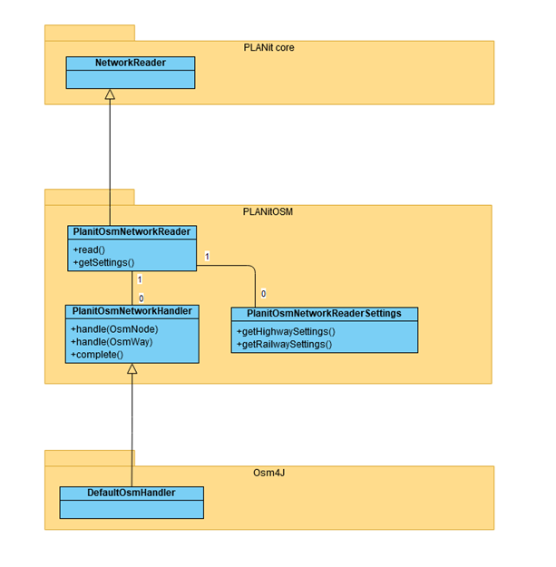
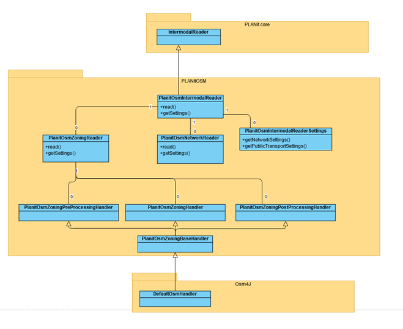

# Introduction

PLANitOSM provides multiple converter readers:

* [Network reader](#planitosmnetworkreader) for road and rail
* [Intermodal reader](#planitosmintermodalreader-and-planitosmzoningreader), that supplements the network reader with public transport infrastructure (not lines, services)
  * The inermodel reader makes use internally of the Zoning reader and the Network reader to provide a combined result

In this readme we provide a quick overview of the class structure and design of these readers. Both readers utilise  
OSM4J to do the low level parsing of OSM entities (nodes, ways, relations), by implementing the respective callbacks 
via a handler class. These handlers are internal to the readers, so the user will not see them.

All readers derive from the PLANit interface NetworkReader, IntermodalReader, respectively. These interfaces only 
dictate the type the reader returns and the way a user can access the configuration options (via a getSettings() method). 
The main benefit of having this structure is that the readers are compatible with the PLANit converters that allow you 
to convert from one format (OSM) into another (X,Y,Z) via a writer that also derives from the same collection of 
interfaces (NetworkWriter, IntermodalWriter etc.).

## PlanitOsmNetworkReader

The reader has a `PlanitOsmNetworkReaderHandler` internally that derives from the OSM4J `DefaultHandler` (see image). 
It overrides the `handle(OsmWay)` and `handle(OsmNode)` methods that are used to feed the handler with the 
parsed OSMEntities for nodes and ways. The network reader will then in turn attempt to parse the nodes and ways 
based on the configuration settings the user provided. These are accessed by the using via the `getSettings()` 
method, which for this reader will return a `PlanitOsmNetworkReaderSettings` instance.

The settings are split into different categories some of which have their own settings. For example all the 
configuration regarding the parsing of OSM ways with the key tag `highway=` are dealt with the 
`PlanitOsmHighwaySettings` class, accessible via `getSettings().getHighwaySettings()`. In case the user has 
activated the railway parser, then the settings pertaining to all OSM ways with key `railway=` are accessible 
via `getSettings().getRailwaySettings()`. 



### General parsing procedure
The parser adopts the following strategy: 

0) Initialise the PLANit in memory network to populate using the default/configuration of the user. 
This includes the activated modes, highway and railway types, and the default link segment types that are mapped 
to these OSM types.
1) Parse and store **all nodes in memory**. While this inflates memory usage since not all nodes are in fact part of 
roads and not all roads are parsed, it ensures that we can always construct all our roads within a single pass of the 
OSM file, speeding up the parsing process. 
2) Then parse all OSM ways as is - even if they are not topologically correct, meaning that they might intersect with 
other OSM ways. 
3) After parsing the roads, we then identify issues regarding the topological validity of the parsed network and break 
links where needed, construct our roundabouts, and possibly remove any dangling subnetworks (if so configured).

### Parsing OSM nodes

- All nodes are parsed and locally stored by their OSM id
- We track the bounding box of the file dynamically based on the OSM node geo information

### Parsing OSM ways basic

OSM ways are first parsed as is, before we consider modifying them in case of issues regarding topology, or other 
aspects that need addressing. However, we do not (yet) parse an OSM way when:

* It is not an activated road or rail based piece of infrastructure
* It is a circular way (these are handled separately afterwards and stored in memory for the time being)

When an OSM way is deemed eligible for parsing it is extracted in its entirety. There are two main aspects to this 
extraction:

* Identifying the link segment type compatible with the OSM way's type and mode access 
tagging (`extractLinkSegmentTypes()`)
* Identifying the link(segment) properties such as geometry and other tags (`layerHandler.extractPartialOsmWay()`)

The link segment type is determined in two steps: 1) collect the default type based on the OSM road/rail type 
(`getDefaultLinkSegmentTypeByOsmWayType()`, 2) modify it based on the specific tagging on the OSM way 
(`updatedLinkSegmentTypeBasedOnOsmWay()`). The former is straightforward, but the latter requires in-depth analysis of 
the tags used to identify what tagging scheme is applied and then extract the mode access. In case a new unique 
combination of properties is found, a new link segment type is registered on PLANit and returned. Depending on whether 
the OSM way is one way or not, the result are at most two link segment types (one per direction), which are then used 
to populate the link segment(s) and the link. 

> In PLANit a link is not directional, it has link segments that are directional. so a link at most has two link 
> segments.

### Parsing circular ways

Circular ways are a special case. they are not parsed directly because in PLANit a link cannot start and end in the 
same location. Therefore, any circular OSM way must be split in at least two links by definition to be viable. This 
processing is done after the parsing of the osm ways (`processCircularWays()`). The circular way must at least have 
one circular section, but it is possible it has multiple and these can be preceded and succeeded with non-circular 
sections. Therefore, this is explicitly catered for when parsing, allowing even the most complex of OSM ways that 
self-intersect and contain loops (`handleRawCircularWay()`). For each circular section PLANit attempts to find 
locations on the OSM way where it intersects with other - already parsed - OSM ways, as these are candidates 
where to split the OSM way since it represents a point of access/egress of the roundabout. If no such point can 
be found, PLANit will make a choice on where to split the circular way.

### Breaking Links

Similar to processing circular ways, OSM ways that are parsed but intersect internally with other parsed OSM ways, 
need to be broken in these locations to create a topologically sound network that can be used for traffic assignment 
(and it is just generally a better way of designing networks). Therefore, PLANit identifies all links that need to be 
broken and does so (`breakLinksWithInternalConnections()`). PLANit itself provides functionality to break links on 
graphs/networks and the OSM reader utilises this functionality provided in the various modifiers 
(`graphModifier.breakEdgesAt()`).

The OSM reader keeps track of which links have been broken as well during this process because it is likely that some 
links are broken multiple times in which case we must be able to identify which of the already broken links is the 
*only* link that needs to be broken again. IF we would take this additional step, all the broken links, or the wrong 
broken link might be broken again, which leads to incorrect networks.

Also, we providean additional listener to this action, namely the `SyncDirectedEdgeXmlIdsToInternalIdOnBreakEdge` 
listener. This ensures that the xml id of the links is synced with the internal id that is guaranteed to remain 
unique even during the breaking of links.

> Note this relies on the fact that the OSM reader initially syncs the xml ids to the internal ids, otherwise this 
> does not work.

> There are implementations to break links both for a graph and directed graph, the latter also supports the breaking 
> of edge segments (link segments). Our networks hold a directed graph internally with nodes, links, and link segments 
> as their elements. Hence, breaking links will eventually end up invoking the modification on a directed graph 
> implementation

### Traffic signals and intersections

When the intersection parser is active (`activateIntersectionParser`, the default), the network reader turns OSM
traffic signals into signalised intersections of the layer. Its settings sit on the intersection settings of the reader
settings, `getIntersectionSettings()`, set up like the highway, railway and waterway settings: the methods named in
this section are found there. An intersection has one or more member nodes, a kind (`junction`,
`crossing`, or both) and its approaches: the link segments entering it that its signals control, only those a
motorised road or rail mode may use. A footway or cycleway entering a signalised crossing is no approach. Once all
signals are handled, an intersection left without an approach is removed and recorded, such as a signalised crossing
where only a footway and a cycleway meet; its node keeps its signal for consolidation. Its external id lists
the OSM node ids of the signals defining it, comma separated, e.g. the stop lines of its arms. Nothing else in the
network changes, except that links can be broken at isolated signalised crossings when that setting is on (see below).

Where it happens:

* Pre-processing records the traffic signals among the eligible OSM nodes, by OSM node id
  (`OsmNetworkReaderData.registerTrafficSignalOsmNodeId`).
* Per layer, at the end of `OsmNetworkLayerParser.complete()`, after `breakLinksWithInternalConnections()`, the
  `OsmTrafficSignalIntegrator` links the recorded signals to the layer's nodes and creates the intersections.
* When the reader removes dangling subnetworks, the clean-up of infrastructure without mode access
  (`MacroscopicNetworkLayerModifier.removeInfrastructureWithoutModeAccess()`) removes the intersections left without
  approaches; its result lists them, and each is recorded as lost by pruning. An intersection whose approaches only
  lose vehicle access, staying open to walking, is kept (X-031).

#### Which signals count

The rules live in `OsmTrafficSignalTags`:

* **vehicle signal** - `highway=traffic_signals`, unless its `traffic_signals=*` value marks a crossing or a signal that
  controls no traffic.
* **crossing signal** - `crossing=traffic_signals`, `crossing:signals=yes`, or `highway=traffic_signals` with
  `traffic_signals=pedestrian_crossing` or `traffic_signals=crossing` (`CROSSING_TRAFFIC_SIGNAL_TYPES`). A `crossing` value
  listing several values, such as `traffic_signals;marked`, counts when one of them does.
* **crossing signal on the crossing way** - many crossings carry their signals only on the crossing way, a footway,
  cycleway or path tagged `crossing=traffic_signals` or `crossing:signals=yes`, not on the node where it crosses the road.
  That node is then a crossing signal as well, also when footways are not parsed. The other nodes of the crossing way,
  such as where it meets the kerb, are not on a road and are no signal. The crossing way is trusted over the node: where
  the node says the crossing has no signals (`crossing=zebra`, `uncontrolled`, `unmarked`, `informal` or `no`, or
  `crossing:signals=no`), it is still a crossing signal, but the case is counted as inconsistent and logged as a warning
  with the ids of the node and the way, so it can be checked in OSM.
* **not controlling traffic** - `traffic_signals=ramp_meter`, `emergency`, `blinker`, `gate`, `control_box` or
  `level_crossing` (`NON_CONTROLLING_TRAFFIC_SIGNAL_TYPES`): ignored and counted.
* A node tagged both `highway=traffic_signals` and `crossing=traffic_signals` is a vehicle signal and a crossing signal, each
  handled by its own rules. OSM uses this both for junctions mapped with signals at their stop lines and for pedestrian
  signals, and no tag tells them apart, so both roles are kept.

#### Junction nodes

A node is a junction node for vehicle signals where three or more links usable by a motorised road mode meet. A crosswalk,
where footways meet the road, is not one: the road simply continues through it. For crossing signals every parsed link
counts, footways included, so where a parsed footway crosses the road the crossing node is a junction node of its own.

A node where a parsed tram or light rail track crosses the road is a junction node for vehicle signals too. The stop line
of a vehicle signal before the track is before the track, so a signal stops there rather than at the road junction
beyond it. Example: on St Kilda Road at High Street, Melbourne, signal 3296124516 stops at the first of the two High
Street tram tracks it reaches.

A road end outside the parsed area is a junction node for vehicle signals as well. Pre-processing keeps a way whole once
one of its nodes lies inside the area, so a road can run on past the edge and end where it reached a junction that is
cut off. The node where it ends, with only one road link, stands in for that junction, as far as a vehicle signal can
reach it like any junction. A signal on that node makes it its junction, and a signal looking ahead along its road can
snap to it. Inside the parsed area such a node is a real dead end and no junction. The parsed area is the bounding area
when one is set, or else the bounds the input file declares (its PBF header box, or the bounds element of OSM XML). A
file that declares none has no edge.

#### The cases, in the order tried

Each signal is handled by the first case that applies, cheapest check first. There are three passes, because later
cases depend on what earlier ones create; the integrator lists the same cases on
`discardPostponeOrConstructIntersection()`, `assignVehicleSignalsToJunctions()` and
`integrateCrossingsAndUnassignedVehicleSignals()`.

First pass, per signal:

1. Not controlling traffic: ignored.
2. Not on a node of the layer nor inside one of its links: ignored.
3. Vehicle signal on a junction node: that node becomes a `junction`, every segment entering it that a motorised road or
   rail mode may use an approach, except a
   segment against the traffic leaving the node (no motorised road or rail mode on it, while its opposite segment
   carries one), which approaches nothing the signal controls.

   ```
                 4
                 |
                 v
        2 --->-- 1 --<--- 3      1: highway=traffic_signals, on the junction's centre
                 ^               arrows mark the approaches
                 |
                 5
   ```

4. Vehicle signal on a road but not on a junction node, e.g. at a stop line before the junction: the junctions it
   reaches are collected for the second pass. The road is
   followed along its motorised segments, through nodes where it simply continues (crosswalks included), up to the
   maximum distance (`setMaximumDistanceVehicleSignalToJunctionInMeters`, default 50 m), in each direction the signal
   applies to:
   * `traffic_signals:direction=forward` or `backward`, relative to the OSM way, only that direction; `both`, both; any
     other value, such as a compass bearing, is handled as untagged and noted;
   * on a one-way road only the direction of travel;
   * no direction tag, or ways through the signal that disagree on their orientation (counted as a direction conflict):
     one direction only, the one whose first target is nearest (second pass).
   Per direction the signal goes to the first eligible junction: one where only service lanes or living streets without
   signals of their own join is passed over when a junction that counts follows within reach.
5. Signal on a track, cycleway or footway (no road through its node): on a track or cycleway its own way is followed,
   on a cycleway only along segments that allow bicycles, to the nearest node a road meets. From a tram or light rail
   track, within the railway settings' maximum (`setMaximumDistanceTrackSignalToRoadCrossingInMeters`, default 50 m),
   that node becomes a `junction`, car traffic being held there for the tram; from a cycleway, within the crossing
   distance (below), a `crossing`; every segment entering it that a motorised road or rail mode may use an approach.
   Where the way branches before a road and more than one branch reaches a road within reach, the branching node
   becomes that intersection instead, with the segment arriving there from the signal as its only approach on a track
   and none on a cycleway, and no road node joined; a branch reaching no road is not a
   candidate. With no road in reach the signal is ignored, as is a signal on any other way, such as a footway. No link is
   broken.

   ```
             12      13
             |       |
     1 ----- 2 ----- 5 ----- 3     road
             |      /
             15 --/                15: the track branches, each branch reaching the road
             |
             11                    11: signal on the track
             |
             10
   ```

   Here 15 becomes a `junction` with approach 10->15 only; neither 2 nor 5 is joined.
6. Crossing signal on a junction node: that node becomes a `crossing`, every segment entering it that a motorised road
   or rail mode may use an approach; with a
   vehicle signal on it as well, it is both a `junction` and a `crossing`.
7. Any other crossing signal is collected for the third pass.

Second pass, per collected vehicle signal, once the signal evidence of every junction is known (a vehicle signal on its node, or
a vehicle signal on another road reaching it first). First, a direction in which the signal reaches a signalised crossing
with no junction within the crossing distance beyond it is dropped: the signal is that crossing's stop line, not the
junction's. A junction where only service lanes or living streets of lower capacity than the road through join, with
no signals of its own, does not count here. Before that, a signal without a usable direction keeps the direction whose
first target is nearest: the junction it would be assigned to there, or an isolated crossing before it; within 10 m,
the junction where the road of higher capacity crosses. A signal with no direction left is counted as such, takes no
part in the signal evidence and waits for the third pass. When every crossing it stops at is one the third pass
ignores at the edge of the parsed area (third pass, 1.), it is ignored with them instead. Then:

1. The junction ahead: in each direction, the segment arriving at the first junction reached becomes its approach. A
   junction where only service lanes or living streets of lower capacity join, with no signals of its own, is passed
   over when another junction follows within the maximum distance. Any other junction takes the signal, even when a
   road of higher capacity crosses further along:

   ```
                                     7
                                     |
        2 ------------------- 1 -4 --- 6 ------ 3      1: vehicle signal, direction forward
                            ~5 m | ~20 m|              4: residential side street, no signals of its own
                                 9     8               6: junction with a primary road
   ```

   Here side street 4 gets approach 2->4 and junction 6 gets nothing.
2. No junction ahead, not even a road end outside the parsed area within reach: collected for the third pass.

Third pass:

1. Per collected crossing signal: part of a signalised junction nearby when, in either direction along the road, the
   first junction reached within the crossing distance (`setMaximumDistanceSignalisedCrossingToJunctionInMeters`,
   default 30 m) is signalised with the arriving segment as one of its approaches; nothing is created for it.

   ```
                              8
                              |
        2 --------------- 31 -- 1 --------------- 3    1: vehicle signal on the junction's centre
                            ~10 m                      31: crossing signal, footways not parsed
                              |
                              9
   ```

   It also is part of a signalised junction when the first junction behind it, going back along the road against the
   traffic within the crossing distance, is signalised: it then lies on one of that junction's exit arms, such as past
   it along a one-way road, where looking along the traffic it faces away from the junction.

   ```
                         7
                         |
        2 ------------>  6 --> 31 ------------> 3   6: vehicle signal on the junction's centre
                         |  ~15 m                   31: crossing signal on the exit arm of one-way way 2-6-31-3
                         8
   ```

   Otherwise, when it lies outside the parsed area, or inside within the crossing distance of its edge, it is ignored:
   a junction it belongs to may be cut off by the edge, so whether it is isolated is unknown. Nothing is created and no
   link is broken. A junction found within reach, a road end outside the parsed area included, still counts as above.

   ```
        ═══════════════════════════ edge of the parsed area
                       |  ~195 m
                       S      1: vehicle signal, stop line of crossing 31: ignored with it
                       X      31: crossing signal, no junction found: ignored
                       |      the side street there lies outside the input file, so it is not in the data
   ```

   Otherwise it is an isolated crossing (4.).
2. Per collected vehicle signal without a junction ahead, all before any of them becomes a crossing, so the result does not
   depend on their order: when a signalised crossing lies ahead along the road within the crossing distance, the signal
   is the stop line of that crossing, and the segment arriving there carries it; it makes no crossing of its own.
3. Of the remaining vehicle signals, one outside the parsed area (on a way running out of it), or inside it within the
   maximum distance of its edge, is ignored: the junction it controls is likely cut off. So is one within the crossing
   distance of a crossing ignored at the edge (1.), as the crow flies: it is likely that crossing's stop line. The
   others are isolated crossings too (4.): what crosses there is unknown, but not only cars. Stop lines of isolated
   crossings from the second pass join their crossing when it has an intersection, and create nothing otherwise.
4. An isolated crossing becomes its own `crossing` intersection, every segment entering it that a motorised road or rail
   mode may use an approach, only when
   breaking links at isolated signalised crossings is on (`setBreakLinksAtIsolatedSignalisedCrossings`, default off);
   the link is then broken at the signal's node when it is not a PLANit node yet. With the setting off nothing is
   created and no link is broken.

   ```
        2 ------------------- 31 ------------------- 3      31: crossing signal, no junction anywhere
                  ~150 m               ~150 m
   ```

   With the setting on, the link is broken at 31, which becomes a crossing with approaches 2->31 and 3->31.

Links broken for an isolated crossing are broken through the layer modifier, so intersections registered before stay
consistent, and a listener keeps the record of signals per approach on the pieces of a broken approach.

Divided roads are not joined: each carriageway's crossing node is a junction of its own, with the approaches that reach
it.

```
    2 ->-- 21 > ------- 5 ------->-- 3      eastbound carriageway
                        |
    8 --<------------- 6 ------ < 23 --<-- 4    westbound carriageway
```

Here 5 and 6 are two intersections; the cross road between them is no approach.

#### Consolidating intersections

OSM maps a junction of divided roads as several nodes, so the integrator makes several intersections for it. With
`setConsolidateIntersections(true)` (off by default) the reader joins them into one, through the layer modifier's
`consolidateIntersections`. It runs once dangling subnetworks are removed and before ids are synced, so only what
remains is consolidated. The intermodal reader holds it back until it has removed dangling subnetworks after the
zoning. When intersections are not parsed it does not run, and a warning says so.

What consolidation does (PLANit's `IntersectionConsolidator`, next to the layer modifier):

1. Intersections with the kind `junction` within 40 m of each other along the road form an intersection cluster.
2. Every way to divide a cluster is scored on how well traffic entering each part can leave it in every direction the
   cluster offers. Every member must earn its place. The best division wins, and a tie goes to fewer parts. A cluster
   of more than 10 parsed intersections is divided step by step instead, keeping the best few divisions per step.
3. Each part becomes one spatial intersection, replacing the intersections it is made from: nodes between them
   become members, and every segment between two members becomes internal. A node in front of the junction stays
   outside, so the roads from it stay approaches with their signals: a fork where a road splits into signalised
   branches, which road traffic only reaches from outside, and a node where a road splits into the carriageways of the
   junction with a signal on the inbound one.
4. A link that road traffic only reaches by driving through the intersection, within 60 m, becomes internal too.
   Then any other junction within the intersection's radius plus 30 m of its centre (from the member nodes roads and
   rails use), reached within 80 m over any
   links, is pulled in, and this repeats until nothing more is: a signal inside a junction belongs to it. A node on
   that connection in front of the junction, such as a fork with signalised branches, stays outside. A connection
   that crosses a tram or light rail track may reach 15 m further, about the width of a tram corridor.
5. A crossing within 40 m of a junction along the road joins it; a crossing no road reaches, such as a footway
   crossing a tram track, looks along any links instead. A crossing on a slip lane joins its junction when it
   lies within 60 m of a member node in a straight line. Then nodes the intersection encloses join it, whatever their
   links carry, such as the nodes of a tram crossover between member nodes: nodes within the intersection's radius
   that connect two or more of its member nodes without leaving it, over links each within 40 m. A node only
   footways, cycleways and the like use also joins when it lies on a connection of at most 50 m between two member
   nodes through such nodes, such as a footway corner between two crossings, however far from the centre. The centre
   and radius count only the member nodes roads and rails use, so footway nodes never widen them. This repeats until
   no more nodes join. A link from an enclosed node to beyond the radius becomes an arm, and a node in front of the
   junction stays out. So does a footway or cycleway node that would hang off the intersection, such as a pavement
   leading away from a corner: one linked to fewer than two of its nodes, or cut off from its member nodes. A footway
   or cycleway segment into a signalised crossing, or into the node of a signal where
   no road or rail passes, becomes an internal segment with a signal.
6. A road entering a signalised junction without being an approach, not on a slip lane, is traced back against the
   traffic, within 80 m, to the first signalised junction within the reach of step 4 plus 15 m. That junction is
   pulled in with the road between them, since the missing signal most likely sits there; the further 15 m apply
   along that road only. Step 4 then runs again, this repeats until nothing more is pulled in, and the intersections
   that grew by pulling in a junction make internal the links now reached only through them, such as a road leaving
   one junction and coming back into the other, and join the nodes they now enclose. Road segments entering a
   signalised junction that are still not
   approaches become approaches without a signal of their own, so movements are stored from them too. Each is recorded as on a slip lane, which often has no signal, or not:
   a road entering a signalised junction without a signal is unusual, so a signal may be missing from OSM.
7. Each spatial intersection stores every movement through it: from each approach to each exit its internal
   segments connect, with its length. A movement stores only a ban placed on it directly; the modes that can make it,
   after mode access and banned turns at member nodes, are worked out when needed.
8. On request (none by default), the chosen modes are collapsed onto a new centre node per spatial intersection, once
   consolidation is done (the layer modifier's `collapseIntersectionsToNonSpatialForModes`). A spatial intersection
   with a node excluded from collapse is left as it is.
   The new turns are banned so each collapsed mode can only make what it could make while the intersection was
   spatial: worked out from the stored movements and, for a segment entering it that is not an approach, such as a
   footway, from what that segment could reach.

Where a vehicle signal stands matters when a segment turns internal: one with a vehicle signal on it becomes an
internal segment with a signal, such as a stop line between the carriageways of a divided road. The integrator
records each vehicle signal it made into an approach, by OSM way, direction and position
(`OsmTrafficSignalIntegrator.isVehicleSignalStandingOn`). That
still holds when a link is broken later, for example by the zoning reader. A signal on a junction node gives no
internal segment a signal, since mappers often tag every node of a junction. A signalised crossing's footway or
cycleway sides are the exception: each has a light of its own, so such an approach into the crossing keeps the
crossing's signal when it turns internal. A road into the crossing does not, in either direction: road traffic stops
for the crossing on the road from outside, which stays an approach, and the road from inside the junction is run by
the junction's own signals.

The values that tune it are PLANit's `IntersectionConsolidatorSettings`, held by the intersection settings: change
them in place through `getIntersectionConsolidatorSettings()`, or switch consolidation on with settings of your own
through `setConsolidateIntersections(true, consolidatorSettings)`. The defaults: maximum joining reach 40 m, minimum
coverage gain per member 0.05, coverage tie margin 0.05, every subdivision tried for clusters of up to 10 parsed
intersections and a larger cluster subdivided step by step keeping 3 subdivisions per step, junctions pulled in
within the radius plus 30 m over a connection of at most 80 m, internal link length
warning 100 m, maximum distance reached only through an intersection 60 m, and
maximum distance from a crossing on a slip lane to its junction 60 m.

The user can change the grouping by OSM node id, each call adding one list of at least two nodes:
`addOsmNodeIdsToJoinIntoOneIntersection` and `addOsmNodeIdsToKeepInSeparateIntersections` on the intersection settings.
Any node of an intersection stands for the whole intersection. Once the crossings have joined, the intersections
holding the nodes of a list to join are joined into one, even where the grouping rules would keep them apart. No step
puts nodes of one list to keep apart into one intersection, and keeping apart wins over joining.

What to collapse is set on `getIntersectionCollapserSettings()`: predefined mode types (`setCollapsedModeTypes`), OSM
modes (`setCollapsedOsmModes`), and OSM nodes whose intersection is not collapsed
(`addOsmNodeIdsExcludedFromCollapse`). The intersection settings are logged as a section of their own,
`Intersections`, next to the way sections, with the consolidation values, when consolidation is on, and the collapse
settings as sections within it. What consolidation and collapse did is logged on one line
each, and each entity is recorded in the PLANit intersections diagnostics below.

With `setComputeGreenRatiosAndSaturationFlowFactors(true)` (off by default) the reader estimates how much of the time
each approach of a signalised intersection has green, since OSM holds no signal timing. It uses PLANit's green ratio
algorithm, tuned on `getGreenRatioAndSaturationFlowFactorSettings()`: approaches on the same axis, facing each other
or arriving side by side such as a road and the tram track beside it, within `setSameAxisApproachToleranceDegrees`
(default 30 degrees), share a phase. A junction with approaches on more axes than `setMaximumNumberOfPhases` (default
4) has the phases whose axes are closest merged until it has that many, since a complex junction gives several
approaches green together. The phases share the usable green time of
the cycle, `setCycleTimeSeconds` (default 90 s) less `setLostTimePerPhaseChangeSeconds` (default 5 s) for each phase.
`setAlgorithmType` chooses how: `EQUAL_SPLIT` (the default) gives each phase the same share, `CAPACITY_WEIGHTED` a
share in proportion to its capacity. For example, a crossing of two equal roads, consolidated, gets two phases and a
green ratio of (90 - 10) / 90 / 2, about 0.44, for each approach. Road traffic at an isolated signalised crossing gets
`setIsolatedCrossingGreenRatio` (default 0.9), and an approach without a signal of its own at a signalised junction a
saturation flow factor of `setApproachWithoutSignalSaturationFlowFactor` (default 0.5). It runs after consolidation and
before collapse, since collapse can move the end of a link and so change the direction an approach arrives in. It also
runs without consolidation, with one warning: a junction parsed as several intersections is then timed as several
junctions. The divided roads crossing above gets two approaches at each of its four nodes, one of them the
carriageway between two nodes, so traffic through it meets two reduced approaches instead of one. What it did is
logged on one line, with how many junctions got each number of phases, for example "(1 phase at 13, 2 phases at 42,
3 phases at 10)", and each intersection whose green ratios could not be computed, because its phases leave no usable
green time, is recorded in the PLANit intersections diagnostics below. The values are written with the network, and
the MATSim writer can reduce link capacities with them.

#### Turn restrictions

An OSM turn restriction via a node becomes banned turns, each naming the modes it bans:

* `restriction=<type>` is for vehicles: it bans every mode that is a vehicle, so not pedestrians, except the modes
  listed in `except` and the modes with a `restriction:<mode>` tag of their own;
* `restriction:<mode>=<type>` bans that mode only;
* OSM modes map to PLANit modes as for access tags, a category such as `psv` standing for its modes; a restriction left
  with no activated mode creates no ban;
* a banned turn bans only the modes that can make it, those allowed on both its segments; a turn none of them can make
  gets no ban, and a ban for every mode that can make its turn names no modes.

Restrictions with a via way are still dropped, and `restriction:conditional` is not read.

#### Diagnostics

What happens is recorded where it is decided, in two stages, and logged at the end of `read()`:

* **OSM traffic signals** (`OsmParseDiagnostics`, `OsmTrafficSignalOutcome`) - the outcomes with a sample of their OSM
  node ids, logged per group (`OsmTrafficSignalOutcomeGroup`), each adding up: signals ignored before their kind
  matters, as a share of all signals recorded; one outcome per vehicle signal, as a share of the vehicle signals; one
  per crossing signal, as a share of the crossing signals, a node with both kinds counted in both; then the notes
  recorded alongside an outcome (e.g. passing a junction joined only by service lanes or living streets, an
  unrecognised direction), as counts only. For vehicle signals left as isolated crossings, a distribution of how far along the road the nearest
  junction is, up to 200 m, follows.
* **PLANit intersections** (`OsmPlanitEntityDiagnostics`, `OsmPlanitEntityIssue`) - the intersections and approaches
  created, and their issues: an intersection lost when pruning removed all its approaches (read from the clean-up's
  result), and an intersection removed for having no approach a motorised road or rail mode can use. With
  consolidation on, also what it did, each entity once: intersections replaced, clusters subdivided step by step,
  nodes joined, approaches made internal, long internal links, links reached only through their intersection,
  junctions pulled in within a radius, crossings joined (along the road or from a slip lane), approaches added
  without a signal (on a slip lane, or not)
  and junctions with few lit arms. With green ratios on, each intersection whose green ratios could not be computed,
  with its usable green time. Also each OSM node id listed to join or keep apart, or excluded from collapse, that no
  layer of the network has, once.

The rules above are covered scenario by scenario in `OsmTrafficSignalsTest`, `OsmTrafficSignalIntegratorTest`,
`OsmIntersectionConsolidationTest` and `OsmTurnRestrictionModesTest`, each hand-made `.osm` file under
`src/test/resources/osm/traffic-signals/` drawn in the test. Consolidation's own rules are tested in PLANit's `IntersectionConsolidationTest`.

### PLANit infrastructure layers

PLANit in principle supports multiple infrastructure layers, where one or more modes are exclusively tied to a layer. 
The OSM reader does support this as well in prinnciple with the functionality always being specific to the layer at 
hand. Practically though no other implementation exists than one with only a single layer containing all modes. so 
while most functionality is layer specific in the reader, in practice we only even user a single layer and it has 
not yet been tested in any other situation.

## PlanitOsmIntermodalReader and PlanitOsmZoningReader

The intermodal reader is not much more than a wrapper around both a `PlanitOsmNetworkReader` and a 
`PlanitOsmZoningReader`. The combination of the two allows for parsing both the road/rail infrastructure 
as well as the (transfer) zones and (directed) connectoids that are used to represent the public transport 
(pt) infrastructure extracted from OSM (that is not directly the road/rail network itself). For more information 
on the network parser see the previous section. In this section we mainly focus on the` PlanitOsmZoningReader` 
component which extract the pt infrastructure.

Parsing public transport infrastructure (bus stop poles, platforms, stations, etc.) in OSM is more difficult than 
parsing a network, mainly because of the existence of multiple tagging schemes for pt as well as the fact that 
these schemes are not trivial to use and therefore many tagging mistakes exist. Also use of some tagging options 
is somewhat ambiguous. The pt component of this parser supports both the original public transport scheme (Ptv1) 
and the new public transport scheme (Ptv2). It also attempts to salvage OSM entities that are tagged wrongly or 
are incomplete if sufficient contextual information is present.

The design of the `PlanitOsmZoningReader` is identical to that of the network, except that it does not manage a 
single OSM handler, but three. See class diagram below. The user will not see these handlers, but they are there 
and as a result the reader conducts three passes over the OSM file in order to be able to extract the pt 
infrastructure. Each of the handlers will be discussed separately in this section. 

Observe that access to the settings is also delegated directly to the underlying settings of the network and 
zoning reader, e.g., `getSettings().getNetworkSettings()` provides access to the network reader settings, whereas 
the `getSettings().getPublicTransportSettings()` provides access to the zoning settings (in this case specifically 
tailored towards pt, hence the name).



### Three passes, Three handlers

Since the order in which OSM entities are parsed is fixed (nodes, ways, relations), we sometimes only know what 
OSM ways need to be parsed after processing the relations. In some cases, the relations reveal that an OSM way 
that is not explicitly tagged for pt, is in fact a pt platform for example. Therefore, if we would only conduct 
a single pass over the file, **all** OSM ways would need to be stored in memory until we can parse the relations. 
To avoid this, we instead conduct multiple passes over the file, where at the sacrifice of some computational speed, 
we significantly reduce the required memory footprint. In the next sections we discuss what each of the three 
handlers (each responsible for one pass across the OSM file) does and why in more detail, but in general this 
is what they do:

* [Pass 1 - preprocessing](#pass-1-preprocessing): No PLANit entities are created yet, only preparation  by flagging some special 
* cases.
* [Pass 2 - main](#pass-2-main): Create transfer zones where possible (platforms, poles), create transfer zone groups, 
* postpone parsing of OSM stations, stop_positions
* [Pass 3 - postprocessing](#pass-3-postprocessing): create connectoids (stop_positions) and process stations (resulting in nothing, 
* transfer zone and/or connectoids)

### Pass 1 Preprocessing

The only task of the preprocessing pass via the `PlanitOsmZoningPreProcessingHandler` is to identify OSM Multipolygons 
that are used as pt platforms. Because they are a multipolygon they do not have any pt specific tags that can identify 
them as a platform, instead they are a member of a public transport `stop_area` relation and their role reveals they
are in fact a platform. Once this is identified (`handle(OsmRelation)`), we flag the OSM way as such and mark that 
the outer border of this platform is to be used for the geometry of this future transfer zone (platform) via 
`markOsmRelationOuterRoleOsmWayToKeep()`. Then during the main pass (Pass 2) when the pt platforms are parsed and 
converted into PLANit transfer zones, it is verified if an OSM way that has no further pt tags is flagged as such 
(`getOuterRoleOsmWayByOsmWayId()` in `extractPtv2OuterRolePlatformRelation()`), if so, the OSM way is converted 
into a platform despite it not having the "normal" tagging. Currently the identification of these multipolygons is 
the only task of the preprocessing pass.

This is the general approach of the various handlers, exceptions to the general tagging rules and special cases are 
flagged in an earlier pass (and the related OSM data stored) to be able to extract the correct PLANit entities at a 
later stages where it would otherwise be missed.

### Pass 2 Main

In the main pass, via the `PlanitOsmZoningHandler` as much of the processing of the pt entities is conducted. Due 
to the dependencies between various pt entities, e.g., a stop_location needs to be matched to a waiting area 
(platform, bus_stop etc.), and the fact that the order of the OSM entities in the parser is often counterproductive 
with respect to these relations, the main phase does not yet parse the stop_locations. Instead, its main 
responsibility is to extract all the waiting areas (platforms, bu_stops, etc., except stations) and convert them 
into PLANit transfer zones:

> Since Ptv2 tagging is both more recent and more comprehensive, the parser attempts to always first parse based on 
> Ptv2 tagging. If not present, it reverts to Ptv1 tagging.

**for nodes and ways tagged with `highway=` and/or `public_transport=`:**
* process platforms with road modes tagged (Ptv2) and convert them into PLANit transfer zones (where possible)
* process bus_stops, platforms tagged (Ptv1) and convert them into PLANit transfer zones (where possible)
* Flag identified stop_positions (Ptv2), and bus stations for later processing (postprocessing)

**for nodes and ways tagged with `railay=` and/or `public_transport=`:**
* process platforms with rail modes tagged (Ptv2) and convert them into PLANit transfer zones (where possible)
* process platforms, stand alone halts (Ptv1) and convert them into PLANit transfer zones (where possible)
* Flag identified stop_positions (Ptv2), and train stations for later processing (postprocessing)

**for relations tagged with :**
* process public transport `stop_area` entities and convert to transfer zone groups (where possible)
* process `multi-polygons` flagged in pre-processing and process as platform, e.g. convert to transfer zones
* process members with role information exceeding tagging information, e.g. role is platform, but no such tagging, 
* and convert to transfer zone (where possible)
* process member without a known role based on tags (whenever possible) and convert to transfer zones if eligible

**general:**
* Identify as many tagging errors or inconsistencies as possible and log them 

> stations are marked of postprocessing. there is however one exception, when a station is explicitly identified 
> as being part of a stop_area when parsing relations, we know for certain the rest of the relation defines the 
> platforms, stops, stop_positions, of that station. So, in this special case, the station is immediately processed 
> (by taking its name and applying it to the stop_area members as the name of the station), and removed from the 
> list of to be processed stations in postprocessing.

### Pass 3 Postprocessing

In post processing we wrap up the parsing by conducting the following main actions:

**for relations tagged with :**
* process public transport `stop_area` `stop_position` and convert to PLANit connectoids

**afterwards :**
* extract remaining flagged OSM entities and convert to appropriate PLANit entities

Now that all transfer zones are known to be available, only then we create the connectoids that might directly 
reference them, or alternatively, we find the correct transfer zone based on contextual or geographical information 
available. The creation of connectoids is complex mainly because the OSM guidelines propose to avoid explicit 
referencing if possible. Hence, in many cases we are left to determine the matching between platform and 
stop_position based on proximity only, and because of this implicit connectoid and the fact that locations of ways, 
nodes, and waiting areas change over time, it is not uncommon for mismatches to occur resulting in a different 
implicit mapping than intended, which in turn can lead to problems in parsing. The process for extracting 
stop_positions and matching them to existing transfer zones is imlpemented roughly as follows:

**stop_position in stop_area:**
When `stop_position` is part of `stop_area`, the stop_position is parsed and matched to a transfer zone in that 
stop_area if possible. It is however possible that the stop_position is missing tagging regarding its mode access, 
in which case the parser adopts the allowed modes of the matched transfer zone instead. If it does have explicit 
modes tagged we utilise those. Finding the appropriate transfer zone within the group 
(via `findTransferZonesForStopPosition()`) however can still be difficult. First, any match found must be mode 
compatible, so a `stop_position` for trams cannot be matched against a bus_stop, this holds for all matching 
attempts. Initially, we attempt to match based on an explicit reference among the transfer zones in the group 
(`ref=`, or alternatives etc.), or by an identical name between stop_location and waiting area 
(both via `findAccessibleTransferZonesByReferenceOrName()`). If no matches are found we attempt to find a match 
spatially (via `findMostLikelyTransferZonesForStopPositionSpatially()`), and then again see if a reference or name 
match can be made, otherwise closest is adopted. In this situation we no longer restrict ourselves to transfer 
zones within the group as it might be that its waiting area is not registered as part of the group. If still no 
match is found, we consider the situation that there is a tagging error and the `stop_position` is wrongly tagged. 
To detect this we now verify if it is also tagged as something else (ptv1 platform for example), but it does reside 
on the road/rail network. If so, we must assume it is both a `stop_position` and a transfer zone in which case we 
create both.If after all these attempts to match the `stop_position`, no match is found we inform the user of the 
problem who can them for example determine to manually override the matching via the configuration.

If a match is found, connectoids are created for the stop_position. In case of a road based `stop_position`, 
the connectoid is placed on the appropriate direction given the location of the waiting area and the driving 
direction of the network. On a rail based track, we place connectoids in both directions since we cannot be certain 
in which direction the vehicle is travelling, unless indicated explicitly. 

> Note that if the `stop_position` is internal to a link, the link is currently always broken in two, creating a 
> node at the "downstream" location of the stop_position with a specifically reference upstream link segment for 
> the PLANit (Directed)Connectoid into which it is converted. The two new links retaining the same OSM id as 
> their external id. We dos o because it is likely

**extracting remaining OSM entities:**
After parsing the relation's stop_positions, the only remaining non-parse OSM entities are the entities that are 
flagged earlier and were skipped for future processing. We have now arrived at this point. These flagged entities 
comprise:

* `stations` not part of a `stop_area`
* `stop_positions` not part of a `stop_area`
* incomplete transfer zones

Each of them is discussed separately below

**processing `station` not in `stop_area`:**
A `station` that is not part of a `stop_area` is either forgotten to be included or it is truly a stand alone 
`station` where no additional information on the platforms and/or stop positions is present. When processing the 
remaining stations, this is verified and appropriate action is taken via `processStationNotPartOfStopArea()`. 
First, find all closeby transfer zones that are mode compatible. If any are present, we select the closest one. 
Then, if that transfer zone belongs to a group, it is assumed the station should have been part of that group and 
the group adopts the station's name if it not already has one, it is then regarded as processed. If no matches are 
found within the specified distance, the `station` is classified as stand alone without additional information. 
Yet, it is assumed the station does represent an actual station so, platforms do exist in reality, just not in OSM. 
To account for that the parser will attempt to create the most likely location (if any) for these platforms and 
attempt to salvage the station (logged to user) via `extractStandAloneStation()`. If the station is located on 
the road/rail, the location of both the stop_position (connectoids) and waiting area (transfer zone) is known 
and both are created. Otherwise the parser will attempt to locate the closest by tracks that are eligible and 
creates stop_positions on the nearest (two in case of a train station) within eligible distance (perpendicular 
to the station), the station itself is converted into a transfer zone. The identification of the eligible links 
is conducted via `findStopLocationLinksForStation()`.

**processing `stop_positions` not in `stop_area`:**
This processing is done utilising the same methods as already described for creating stop_positions in a 
`stop_area` (via `findTransferZonesForStopPosition()`) , the only difference being that the matching against 
reference or names is not done by the group it belongs to (there is no group), otherwise it is identical.

**incomplete transfer zones**
finally we process all transfer zones that were creataed but where never matched against a `stop_position` 
via `processIncompleteTransferZone()`. This is typically a sizeable number due to the implicit nature and/or 
complete absence of stop_positions in OSM, especially in the Ptv1 tagging scheme. Similar to stations, we 
attempt to identify existing closeby links (via `findModeDistanceCompatibleStopLocationLinksForWaitingArea()`) 
as eligible locations for a stop_position that  - even though not explicitly present - implicitly is assumed to 
exist. From the found links (if any), the most likely one is selected if there are more than one via 
`findMostAppropriateVehicleStopConnectoidLinkForWaitingArea()`. We find the closest one as well as the other links 
that are close by to the closest link. This contingency is needed because OSM dictates the closest node to use, but PLANit 
requires a link segment to match. since the closest node can provide access to multiple link segments, all equally 
close, or almost equal, this buffer distance is needed to perform futher filtering. If multiple options remain the 
close by links are filtered based on being compatible in terms of the driving direction (if transfer zone is not rail 
based) via `findDrivingDirectionCompatibleLinks()`. For the remaining links it is checked if a valid stop location 
can be created and from those that remain an option the most important road type is selected (the assumption being 
that stops are generally located for main roads rather than small roads). If after all this still multiple options 
remain, the closest one is selected definitively.

The connectoids on the selected link  are then created ideally on an existing OSM node if close enough, otherwise a 
new node location is inserted and the link is broken in the location of the created connectoid (virtual stop_position).

